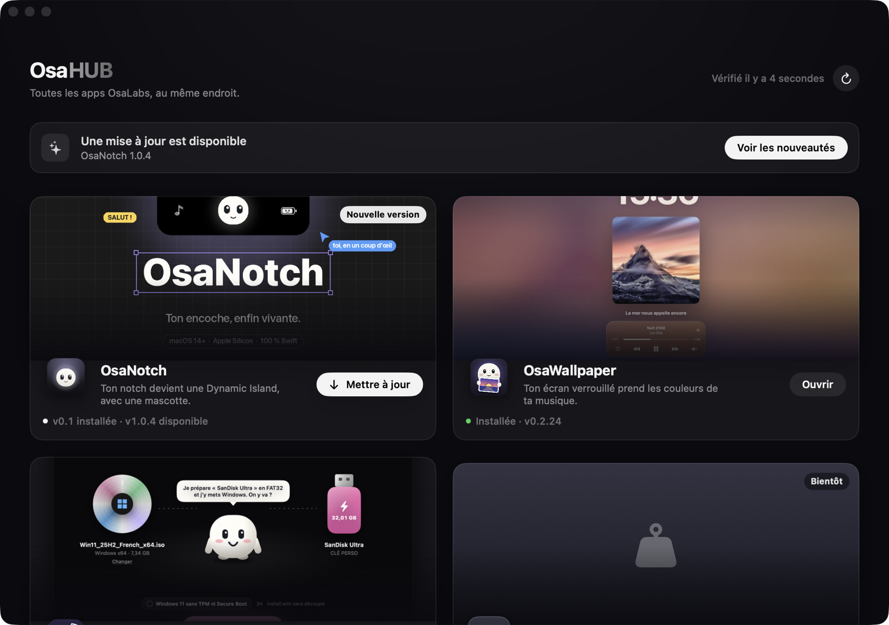
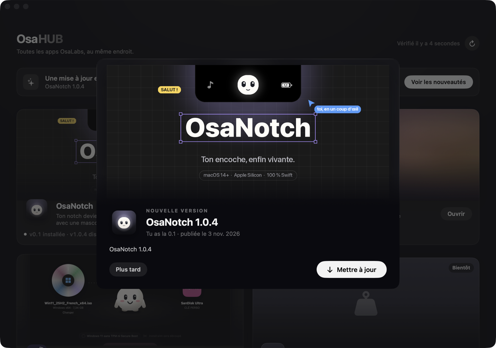
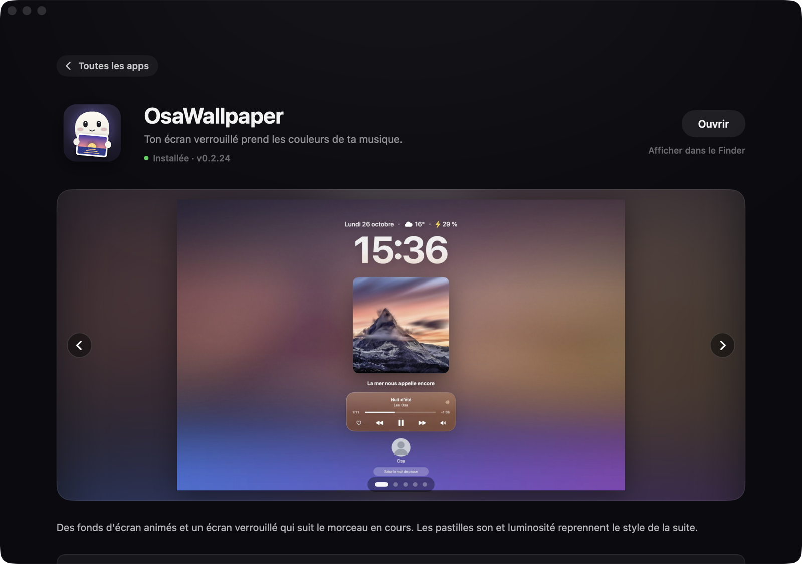

<h1 align="center">OsaHUB</h1>

Toutes les apps OsaLabs pour Mac au même endroit : les installer, les mettre à jour, voir leurs nouveautés.

  
  
  

## Ce qu'il fait

- **Un catalogue** : OsaNotch, OsaWallpaper, OsaBoot, OsaWeight… avec leurs captures, leur version installée et la dernière publiée.
- **Installer en un clic** : OsaHUB télécharge l'app depuis sa release GitHub, vérifie que l'archive contient bien la bonne app (identifiant + signature intacte), puis la range dans Applications.
- **Les nouveautés à chaque mise à jour** : quand une app installée a une nouvelle version, OsaHUB affiche ses notes de version avec ses captures, puis la met à jour. Si l'app tournait, il la quitte et la relance.
- **Il veille** : fenêtre fermée, OsaHUB reste dans la barre des menus, vérifie toutes les 6 heures et envoie une notification. Il peut s'ouvrir à la connexion.
- **Une ouverture animée** : « OsaHUB » en motion design, noir et blanc comme le reste de la suite. Un clic la passe.

  
  

## Installation

1. Télécharge `OsaHUB.dmg` depuis la [dernière release](https://github.com/osayanis/osahub/releases/latest).
2. Glisse OsaHUB dans Applications.
3. La première fois : **clic droit → Ouvrir** (l'app n'est pas notarisée par Apple).

Mac Apple Silicon, macOS 14 ou plus.

## Ajouter une app ou des captures

- **Le catalogue** est `catalog.json`, lu en ligne au lancement : ajouter une app ici suffit, sans republier OsaHUB. Le catalogue embarqué dans l'app sert hors ligne.
- **Une app du catalogue** doit avoir des releases GitHub publiques avec son archive (`NomApp.zip`, faite avec `ditto -c -k --keepParent`). Son Info.plist doit porter la vraie version (`CFBundleShortVersionString`) : c'est elle qu'OsaHUB compare.
- **Les captures des nouveautés** : mets des images dans les notes de la release (``, ou glisse une image dans l'éditeur de GitHub) ou joins des PNG/JPG à la release. Sans images, OsaHUB montre les captures du catalogue.

## Technique

SwiftUI + AppKit, aucune dépendance. API GitHub sans compte (60 requêtes par heure : une vérification en coûte une par app). `./build.sh` construit l'app, `./publish.sh X.Y.Z notes.md` la publie.

Pour les tests : `OsaHub verifier` télécharge et contrôle la dernière archive de chaque app sans rien installer. `OsaHub essai <id> <dossier>` fait une installation complète dans un autre dossier que Applications, sans toucher aux apps ouvertes.
